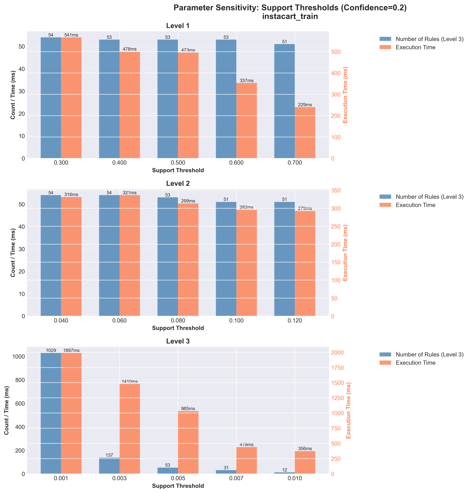
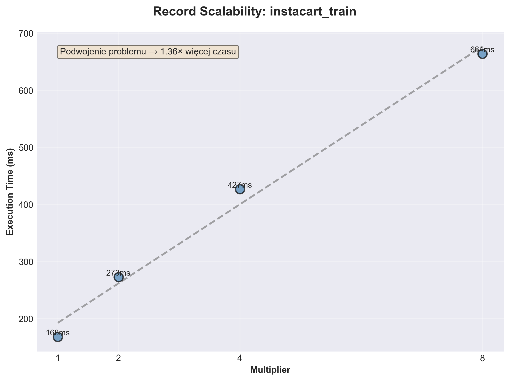
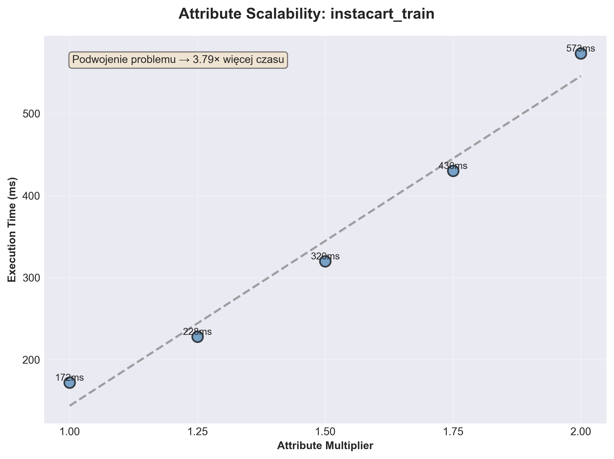
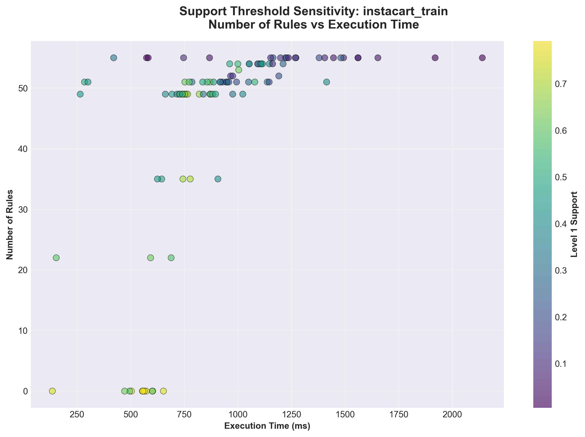

# HQApriori

Rust implementation of multi-level association rule mining, following Han and Fu (1999). The program mines frequent itemsets and association rules on a concept taxonomy, with a separate support and confidence threshold at each level.

The evaluation uses two Instacart market-basket files and a three-level product taxonomy (department, aisle, product). Transaction files are not included in this repository.

## Task

Given a set of transactions and a taxonomy, find association rules of the form X → Y at one or more levels of abstraction. Higher levels use broader concepts and higher support thresholds. Items that are infrequent at a given level are discarded together with their descendants, so lower levels are searched only under frequent ancestors.

## Method

- Top-down search of the taxonomy (progressive deepening).
- Classic Apriori at each level: candidate join, prune, then support counting.
- A separate minimum support, minimum confidence, and rule-generation flag per level.
- Transaction membership stored in compressed bitmaps (Roaring). Support of an itemset is the size of the bitmap intersection.
- The taxonomy is a tree. An internal node’s bitmap is the union of its children.

## Usage

Rust 1.70 or newer is required. Place the transaction file and the taxonomy file under `datasets/`, then:

```bash
cargo test
cargo run --release
```

`cargo test` runs the full unit and integration suite. The implementation is fully covered by tests.

The example below is the library API used by `src/main.rs`. Level 1 is the top of the taxonomy. Only level 3 emits rules.

```rust
use hqapriori_med::apriori::{sort_rules, Apriori, LevelConfig, SortBy};
use std::collections::HashMap;

fn main() -> Result<(), Box<dyn std::error::Error>> {
    let mut configs = HashMap::new();
    configs.insert(1, LevelConfig { support: 0.5, confidence: 0.2, gen_rules: false });
    configs.insert(2, LevelConfig { support: 0.08, confidence: 0.2, gen_rules: false });
    configs.insert(3, LevelConfig { support: 0.005, confidence: 0.2, gen_rules: true });

    let mut apriori = Apriori::new(
        "datasets/instacart_trainFIM.txt",
        "datasets/instacart_taxonomy.txt",
        configs,
    )?;

    let mut rules_by_level = apriori.mine();
    if let Some(rules) = rules_by_level.get_mut(&3) {
        sort_rules(rules, SortBy::ConfidenceSupport);
        for rule in rules.iter().take(10) {
            rule.print(&apriori.repository);
        }
    }
    Ok(())
}
```

Transactions are one itemset per line, names separated by spaces. Lines starting with `@` are ignored. The taxonomy is CSV, `child,parent`, one edge per line. Names in both files must match. A negative level index counts from the leaves (`-1` is the last level).

The experimental suite writes JSON under `experiments/`:

```bash
cargo run --release --bin experiments
```

Plots in this README were produced from those files with `generate_plots.py`.

## Selected results

Figures below are for `instacart_train`. The same plots for `instacart_prior` are in `experiments/plots/instacart_prior/`. Times are averages of repeated runs.

### Support threshold

Confidence is fixed at 0.2. Blue bars are the number of rules at level 3. Orange bars are total runtime (right axis).



Raising support at level 1 or 2 changes the level-3 rule count only slightly (about 51–54 rules) and mainly reduces runtime. Support at level 3 is the binding constraint: the rule count falls from 1029 at support 0.001 to 12 at support 0.01, and runtime falls from about 1.9 s to 0.36 s.

### Number of transactions

Transactions were duplicated with bitmap offsets (1x, 2x, 4x, 8x), so the item distribution stays the same.



Runtime grows slower than the number of records: 168 ms at 1x and 664 ms at 8x. Doubling the data costs about 1.36 times more time, because candidate generation depends on the taxonomy more than on the number of transactions.

### Number of attributes

Synthetic leaves were added to the taxonomy (multipliers 1.0 to 2.0).



A wider attribute space is more expensive than more transactions. Doubling the attributes (1.0 to 2.0) raises runtime from 172 ms to 573 ms, about 3.8 times.

### Pruning at higher levels

Level-3 support is fixed at 0.005 and confidence at 0.2. Level-1 and level-2 support are drawn at random (100 runs). Colour is the level-1 support.



A high threshold at level 1 often removes every ancestor of the products that would form rules, so the run finishes with 0 rules and a short time. Lower level-1 support keeps about 50 rules and takes longer. This is the trade-off of hierarchical pruning.

### One pass versus three independent passes

The same three thresholds were also mined as three separate Apriori runs (one level each) and as a single hierarchical pass.

| Dataset | Three passes | One pass | Time saved |
| --- | ---: | ---: | ---: |
| instacart_train | 745 ms, 147 rules | 313 ms, 138 rules | 58% |
| instacart_prior | 65.9 s, 112 rules | 22.9 s, 105 rules | 65% |

The single pass is faster because infrequent nodes are not expanded. It also returns slightly fewer rules: descendants of an infrequent ancestor are not mined.

## Report

The full project report, in Polish, is [full_report_pl.pdf](full_report_pl.pdf).

## Reference

Jiawei Han and Yongjian Fu, "Mining multiple-level association rules in large databases," *IEEE Transactions on Knowledge and Data Engineering*, vol. 11, no. 5, pp. 798–805, Sept.–Oct. 1999, doi: [10.1109/69.806937](https://doi.org/10.1109/69.806937).
